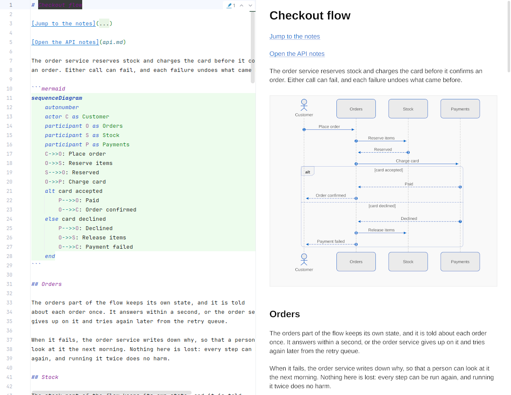
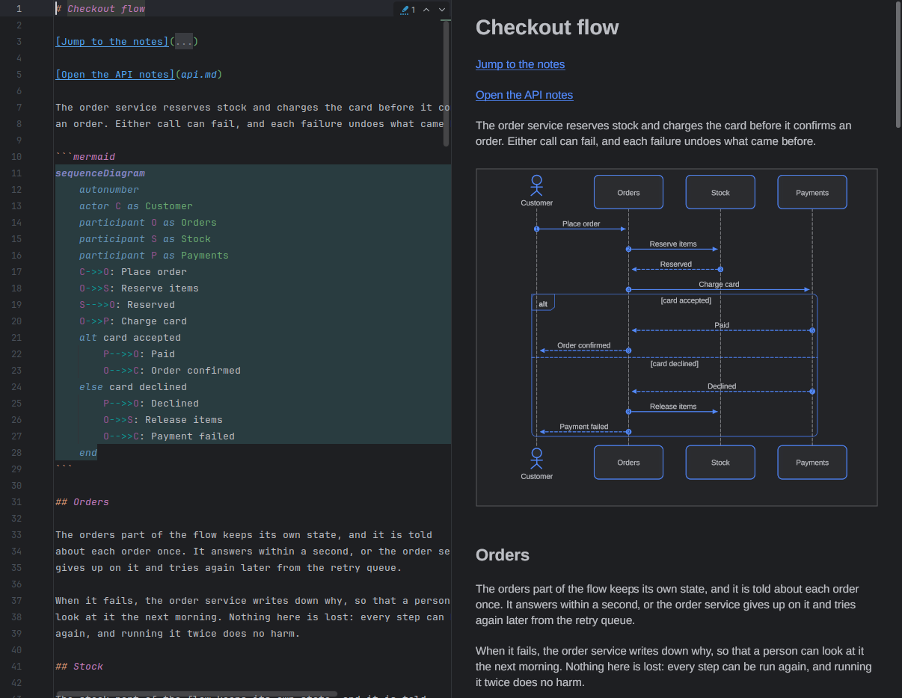

<p align="center">
  
</p>

<h1 align="center">dyamark</h1>

<p align="center">
  A fast, native Markdown viewer and editor that draws Mermaid sequence diagrams faithfully, without a browser engine.
</p>

<p align="center">
  <a href="https://github.com/shakilnwz/dyamark/releases/latest"></a>
  <a href="LICENSE"></a>
</p>

| Light | Dark |
|---|---|
|  |  |

## What is dyamark?

dyamark renders Markdown with Mermaid sequence diagrams drawn natively. It's
a single Go binary drawn on the GPU with [Gio](https://gioui.org), and it
starts in about 100 ms. Its layout engine is a port of Mermaid's own, tested
to match `mmdc` within 2 px.

Made for [Omarchy](https://omarchy.org), it follows the theme live and
should run on any Wayland desktop. It's also available as a Markdown preview
plugin for JetBrains IDEs.

## Features

- GitHub-flavoured Markdown with sequence diagrams inline
- Fullscreen diagram viewer: zoom, pan, fit, pinned participants, and
  focus on one participant
- Source and side-by-side editing, with atomic auto-save and live reload
- Other Mermaid diagram types rendered on demand with `mmdc`
- Keyboard first: press `?` for every key

## Installation

Download a package from the
[latest release](https://github.com/shakilnwz/dyamark/releases/latest)
(x86-64, glibc 2.39+, Wayland):

```bash
sudo pacman -U dyamark-<version>-1-x86_64.pkg.tar.zst   # Arch / Omarchy
sudo apt install ./dyamark_<version>-1_amd64.deb        # Debian / Ubuntu
sudo dnf install ./dyamark-<version>-1.x86_64.rpm       # Fedora
```

Or build from source with Go 1.27+ and the Wayland, xkbcommon and EGL/GLES
development files:

```bash
git clone https://github.com/shakilnwz/dyamark.git
cd dyamark
./bin/build      # builds build/dyamark
./bin/install    # Arch: builds and installs the package
```

## Usage

```bash
dyamark notes.md
```

| Key | Action |
|---|---|
| `Ctrl+O` / `Ctrl+S` / `Ctrl+Shift+S` | Open / save / save as |
| `Ctrl+F` | Find |
| `Ctrl+E` | Source / view |
| `Ctrl+\` | Source and view side by side |
| `Tab` / `Shift+Tab` | Move between diagrams |
| `Enter` / click | Open the diagram viewer |
| Scroll / `Shift`+scroll | Move the diagram up and down / sideways (viewer) |
| `Ctrl`+scroll | Zoom at the pointer (viewer) |
| `+` `-` `0` `1` `W` `H` | Zoom, fit, 100 %, fit width / height (viewer) |
| `N` | Toggle sequence numbers (viewer) |
| `E` | Edit this diagram's source (viewer) |
| `R` | Render another Mermaid diagram type with `mmdc` |
| `Ctrl+=` / `Ctrl+-` / `Ctrl+0` | Text size |
| `?` / `F1` | List all keys |
| `Ctrl+Q` | Quit |

## JetBrains plugin

A Markdown preview for PhpStorm 2026.2 and newer (and other IntelliJ-based
IDEs on those builds), with the same diagrams and viewer, colours from the
editor scheme, and scroll sync.

1. Download `dyamark-jetbrains-<version>.zip` from the
   [latest release](https://github.com/shakilnwz/dyamark/releases/latest).
2. **Settings › Plugins › ⚙ › Install Plugin from Disk…**, and choose the zip.
3. Open a Markdown file and click **Use Dyamark**.

### Requirements

- **PhpStorm 2026.2 or newer** (build 262 and up). Other IntelliJ-based IDEs
  should work, but only PhpStorm is tested. The plugin sets no upper version,
  so it keeps loading as PhpStorm updates. The Markdown preview API it uses
  is experimental, so an update can still break it; a weekly check against
  PhpStorm's newest releases is there to catch that.
- The bundled **Markdown** plugin, enabled.
- **JCEF**, which the IDE's default runtime (JetBrains Runtime) has.
- **WebGL**, so leave the IDE's browser GPU on (the default). If
  `ide.browser.jcef.gpu.disable` is set in the Registry, add
  `--enable-unsafe-swiftshader` to `ide.browser.jcef.extra.args` for
  software WebGL. Without WebGL the preview says so instead of drawing.
- About 40 MB more memory per open preview than the built-in one.

### Using it

- Switch previews under **Settings › Languages & Frameworks › Markdown ›
  Preview**, or with the one-time **Use Dyamark** notification. From 2026.3
  the choice is for the whole IDE, and only the tab showing swaps at once;
  other open tabs follow when you reopen them.
- The keys are the desktop app's; `?` lists them. **Ctrl+=**, **Ctrl+-**
  and **Ctrl+0** zoom the focused preview. In the diagram viewer, scrolling
  moves the diagram, **Ctrl**+scrolling zooms it, and **E** puts the caret on
  the diagram's source.
- The preview draws at 60 fps on 2026.2 and 120 fps from 2026.3. Set
  `ide.browser.jcef.osr.framerate` in the Registry to change it; a lower
  rate is less smooth but leaves the IDE more room.
- Only sequence diagrams are drawn; other Mermaid types show as source.
- Text is drawn with the bundled Liberation fonts, so scripts they don't
  cover, such as CJK, show as boxes.

## Development

```bash
./bin/test     # gofmt, go vet and tests
./bin/build    # desktop binary
./bin/plugin   # JetBrains plugin (needs JDK 25, or PhpStorm's bundled JBR)
```

## Licence

[MIT](LICENSE). The sequence layout is ported from
[Mermaid](https://github.com/mermaid-js/mermaid) and the parser from
[mmgo](https://github.com/julianshen/mmgo), both MIT. The bundled
Liberation fonts are under the SIL OFL.
