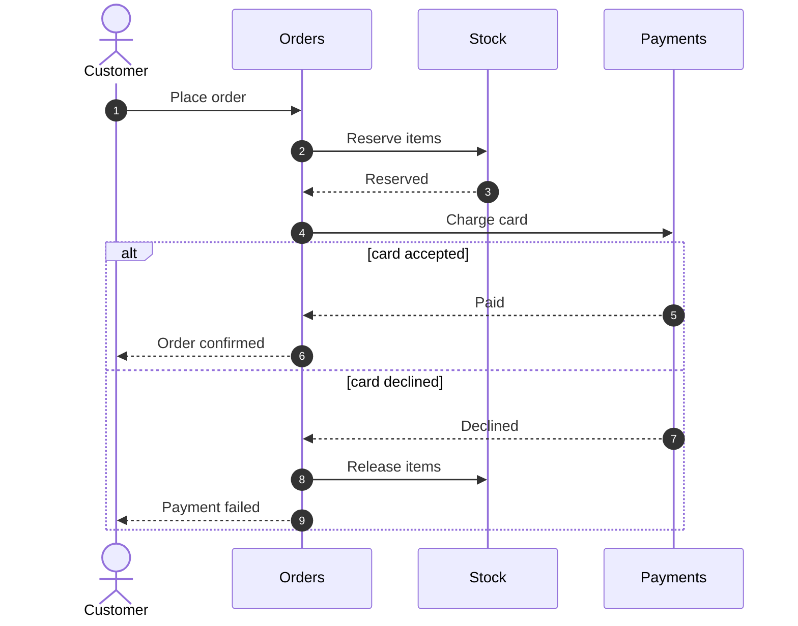
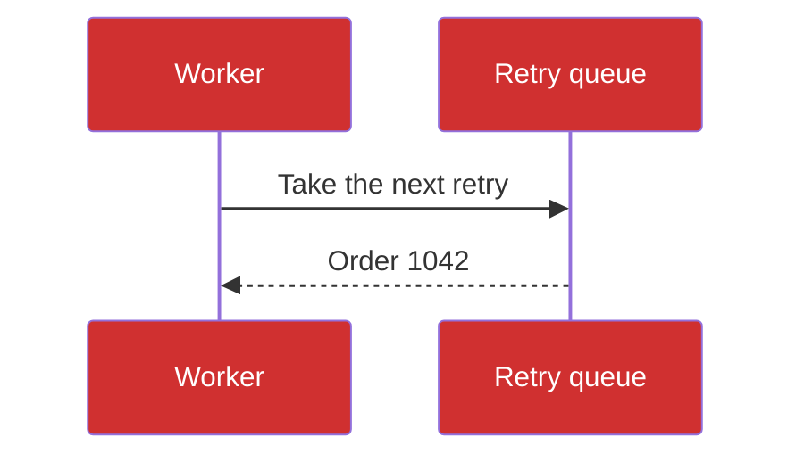

# Checkout flow

[Jump to the notes](#notes-and-follow-ups)

[Open the API notes](api.md)

The order service reserves stock and charges the card before it confirms
an order. Either call can fail, and each failure undoes what came before.

## Orders

The orders part of the flow keeps its own state, and it is told
about each order once. It answers within a second, or the order service
gives up on it and tries again later from the retry queue.

When it fails, the order service writes down why, so that a person can
look at it the next morning. Nothing here is lost: every step can be run
again, and running it twice does no harm.

## Stock

The stock part of the flow keeps its own state, and it is told
about each order once. It answers within a second, or the order service
gives up on it and tries again later from the retry queue.

When it fails, the order service writes down why, so that a person can
look at it the next morning. Nothing here is lost: every step can be run
again, and running it twice does no harm.

## Payments

The payments part of the flow keeps its own state, and it is told
about each order once. It answers within a second, or the order service
gives up on it and tries again later from the retry queue.

When it fails, the order service writes down why, so that a person can
look at it the next morning. Nothing here is lost: every step can be run
again, and running it twice does no harm.

## Retries

The retries part of the flow keeps its own state, and it is told
about each order once. It answers within a second, or the order service
gives up on it and tries again later from the retry queue.

When it fails, the order service writes down why, so that a person can
look at it the next morning. Nothing here is lost: every step can be run
again, and running it twice does no harm.

## Refunds

The refunds part of the flow keeps its own state, and it is told
about each order once. It answers within a second, or the order service
gives up on it and tries again later from the retry queue.

When it fails, the order service writes down why, so that a person can
look at it the next morning. Nothing here is lost: every step can be run
again, and running it twice does no harm.

## Emails

The emails part of the flow keeps its own state, and it is told
about each order once. It answers within a second, or the order service
gives up on it and tries again later from the retry queue.

When it fails, the order service writes down why, so that a person can
look at it the next morning. Nothing here is lost: every step can be run
again, and running it twice does no harm.

## Fraud checks

The fraud checks part of the flow keeps its own state, and it is told
about each order once. It answers within a second, or the order service
gives up on it and tries again later from the retry queue.

When it fails, the order service writes down why, so that a person can
look at it the next morning. Nothing here is lost: every step can be run
again, and running it twice does no harm.

## Reports

The reports part of the flow keeps its own state, and it is told
about each order once. It answers within a second, or the order service
gives up on it and tries again later from the retry queue.

When it fails, the order service writes down why, so that a person can
look at it the next morning. Nothing here is lost: every step can be run
again, and running it twice does no harm.

## Limits

The limits part of the flow keeps its own state, and it is told
about each order once. It answers within a second, or the order service
gives up on it and tries again later from the retry queue.

When it fails, the order service writes down why, so that a person can
look at it the next morning. Nothing here is lost: every step can be run
again, and running it twice does no harm.

## Timeouts

The timeouts part of the flow keeps its own state, and it is told
about each order once. It answers within a second, or the order service
gives up on it and tries again later from the retry queue.

When it fails, the order service writes down why, so that a person can
look at it the next morning. Nothing here is lost: every step can be run
again, and running it twice does no harm.

## Logging

The logging part of the flow keeps its own state, and it is told
about each order once. It answers within a second, or the order service
gives up on it and tries again later from the retry queue.

When it fails, the order service writes down why, so that a person can
look at it the next morning. Nothing here is lost: every step can be run
again, and running it twice does no harm.

## Alerts

The alerts part of the flow keeps its own state, and it is told
about each order once. It answers within a second, or the order service
gives up on it and tries again later from the retry queue.

When it fails, the order service writes down why, so that a person can
look at it the next morning. Nothing here is lost: every step can be run
again, and running it twice does no harm.

## A worker with its own colours

## Notes and follow-ups

1. A note to follow up on, number 1, kept short.
2. A note to follow up on, number 2, kept short.
3. A note to follow up on, number 3, kept short.
4. A note to follow up on, number 4, kept short.
5. A note to follow up on, number 5, kept short.
6. A note to follow up on, number 6, kept short.
7. A note to follow up on, number 7, kept short.
8. A note to follow up on, number 8, kept short.
9. A note to follow up on, number 9, kept short.
10. A note to follow up on, number 10, kept short.
11. A note to follow up on, number 11, kept short.
12. A note to follow up on, number 12, kept short.
13. A note to follow up on, number 13, kept short.
14. A note to follow up on, number 14, kept short.
15. A note to follow up on, number 15, kept short.
16. A note to follow up on, number 16, kept short.
17. A note to follow up on, number 17, kept short.
18. A note to follow up on, number 18, kept short.
19. A note to follow up on, number 19, kept short.
20. A note to follow up on, number 20, kept short.
21. A note to follow up on, number 21, kept short.
22. A note to follow up on, number 22, kept short.
23. A note to follow up on, number 23, kept short.
24. A note to follow up on, number 24, kept short.
25. A note to follow up on, number 25, kept short.
26. A note to follow up on, number 26, kept short.
27. A note to follow up on, number 27, kept short.
28. A note to follow up on, number 28, kept short.
29. A note to follow up on, number 29, kept short.
30. A note to follow up on, number 30, kept short.
31. A note to follow up on, number 31, kept short.
32. A note to follow up on, number 32, kept short.
33. A note to follow up on, number 33, kept short.
34. A note to follow up on, number 34, kept short.
35. A note to follow up on, number 35, kept short.
36. A note to follow up on, number 36, kept short.
37. A note to follow up on, number 37, kept short.
38. A note to follow up on, number 38, kept short.
39. A note to follow up on, number 39, kept short.
40. A note to follow up on, number 40, kept short.
41. A note to follow up on, number 41, kept short.
42. A note to follow up on, number 42, kept short.
43. A note to follow up on, number 43, kept short.
44. A note to follow up on, number 44, kept short.
45. A note to follow up on, number 45, kept short.
46. A note to follow up on, number 46, kept short.
47. A note to follow up on, number 47, kept short.
48. A note to follow up on, number 48, kept short.
49. A note to follow up on, number 49, kept short.
50. A note to follow up on, number 50, kept short.

The end.
